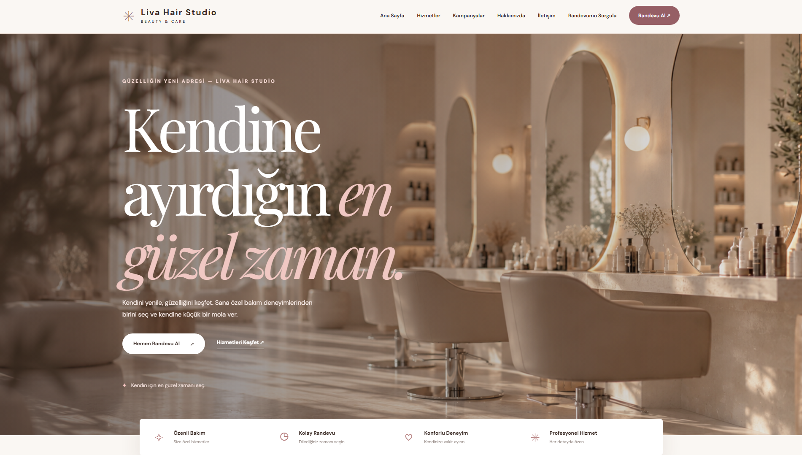
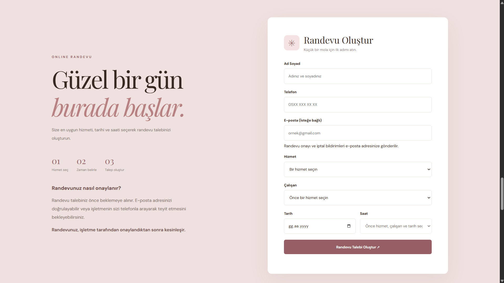
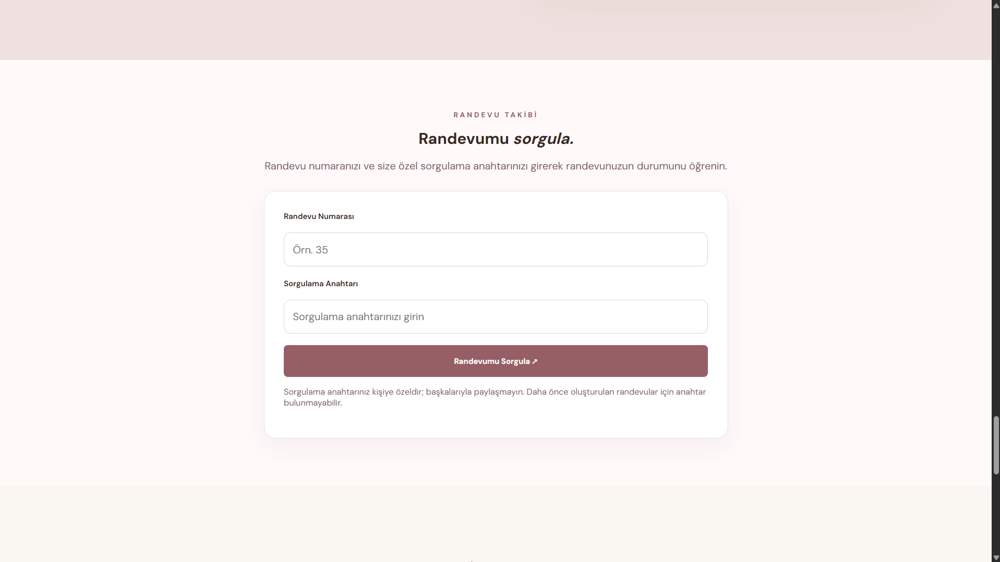
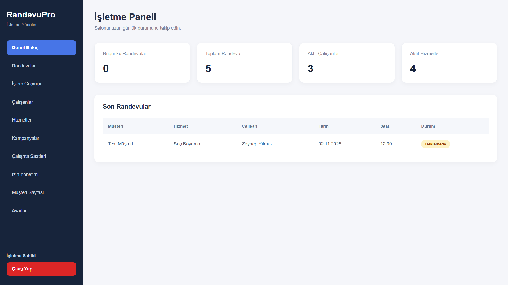
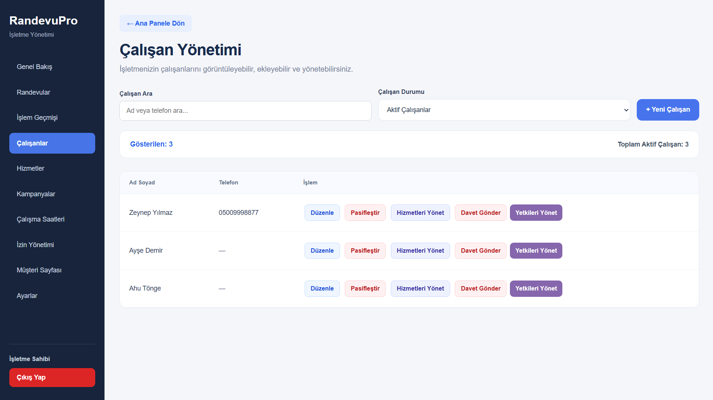
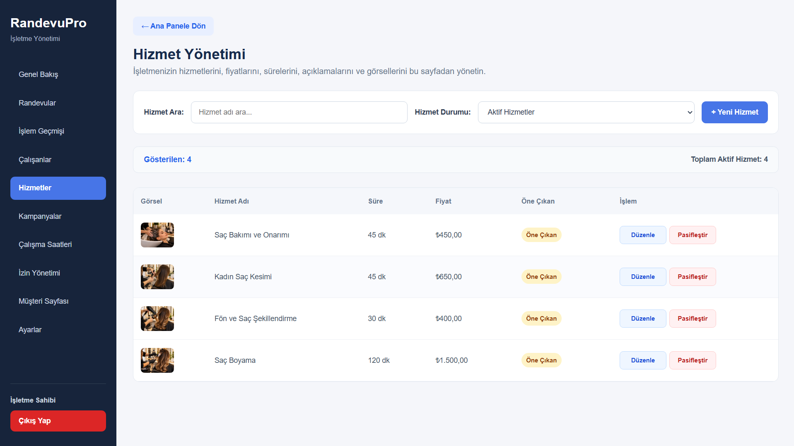
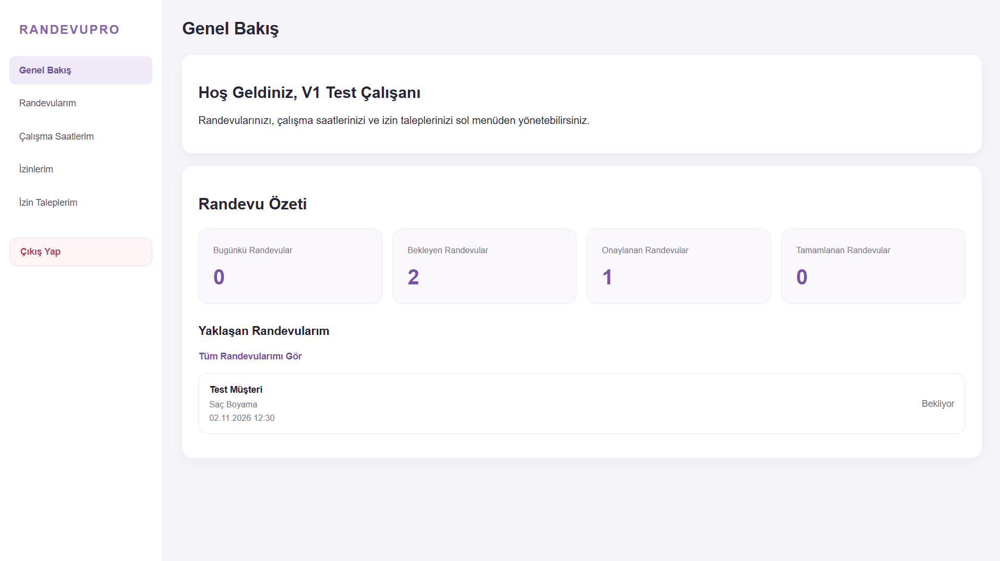
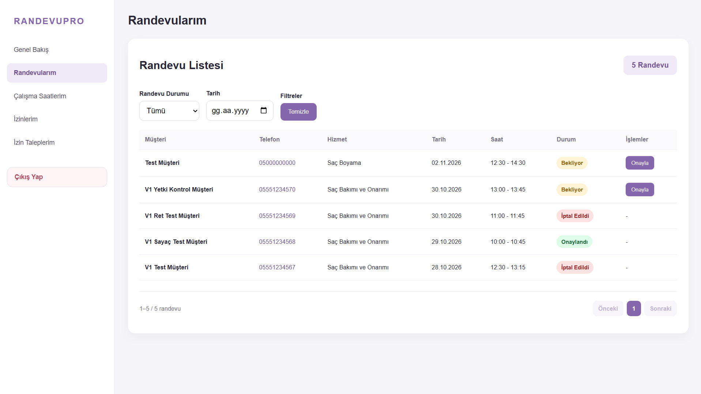
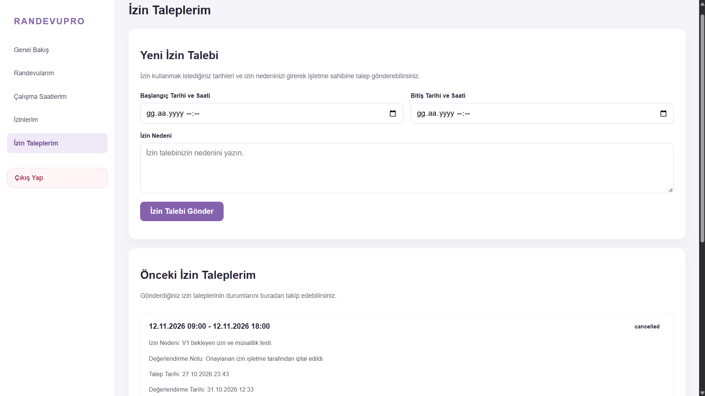

# RandevuPro

**Web-Based Appointment Management System**

🇹🇷 [Türkçe](README_TR.md) | 🇬🇧 **English**

RandevuPro is a web-based appointment management system designed for service-based businesses. It provides an intuitive booking experience for customers and dedicated management panels for business owners, employees, and system administrators.

The system aims to simplify appointment scheduling, employee management, and daily business operations through a centralized platform.

---

## Key Features

### Customer Interface

Customers can explore services, choose their preferred employee, and book appointments through a user-friendly interface.

- Browse available services and employees
- Select appointment dates and available time slots
- Book appointments with email verification
- Look up existing appointments
- Benefit from applicable promotional campaigns

### Business Owner Panel

Business owners can manage appointments, employees, and services from a centralized dashboard. The panel also provides tools for configuring business operations, managing staff permissions, and customizing the customer-facing website.

- Manage appointments, employees, and services
- Configure employee permissions and working hours
- Manage leave and time-off schedules
- Create and manage promotional campaigns
- Review appointment activity history
- Customize public business page content

### Employee Panel

Employees have access to a dedicated panel where they can monitor their appointments, perform permitted operations, and manage their time-off requests.

- View assigned appointments
- Manage appointments according to permissions
- View working schedules
- Submit and track time-off requests

### Super Admin Panel

The application includes a separate administration area for system-level management.

---

## Technologies Used

| Category | Technologies |
|---|---|
| Backend | Python, Flask |
| Database | PostgreSQL |
| Frontend | HTML, CSS, JavaScript |
| Email Integration | Resend |
| Security | CSRF Protection, Authentication, Role-Based Authorization, Login Rate Limiting |
| Version Control | Git, GitHub |

---

## Screenshots

The following screenshots demonstrate the main interfaces and management features of RandevuPro.

### Customer Interface

The customer-facing interface allows users to explore services, make reservations, and look up their existing appointments.

#### Home Page

#### Services

#### Appointment Booking

#### Appointment Lookup

---

### Business Owner Panel

The business owner dashboard provides centralized control over appointments, employees, services, and business operations.

#### Dashboard

#### Employee Management

#### Service Management

---

### Employee Panel

The employee dashboard enables staff members to manage assigned appointments and submit time-off requests based on their permissions.

#### Dashboard

#### Appointment Management

#### Time-Off Requests

---

## Security Features

RandevuPro incorporates several security mechanisms to protect user sessions and application operations.

- Session-based authentication
- Role-based access control
- CSRF protection for sensitive operations
- Login rate limiting
- Permission-based employee operations
- Protected management API endpoints

---

## Project Status

**Portfolio Version 1.0 — Final Testing and Documentation**

The project is currently undergoing final testing, interface improvements, and documentation updates.

Planned presentation materials include a demonstration video showcasing the customer booking process and management panels.

---

## Source Code and Availability

RandevuPro is a personal software engineering portfolio project.

The complete application source code is maintained in a **private repository**.

This public repository is dedicated exclusively to showcasing the project's features, technologies, interface designs, and demonstration materials.

**The application source code is not publicly distributed through this repository.**

---

## Developer

**Sude Güngör**

Software Engineer

- [GitHub](https://github.com/sudenurgungor)
- [Portfolio](https://sudenurgungor.github.io/portfolio/)
