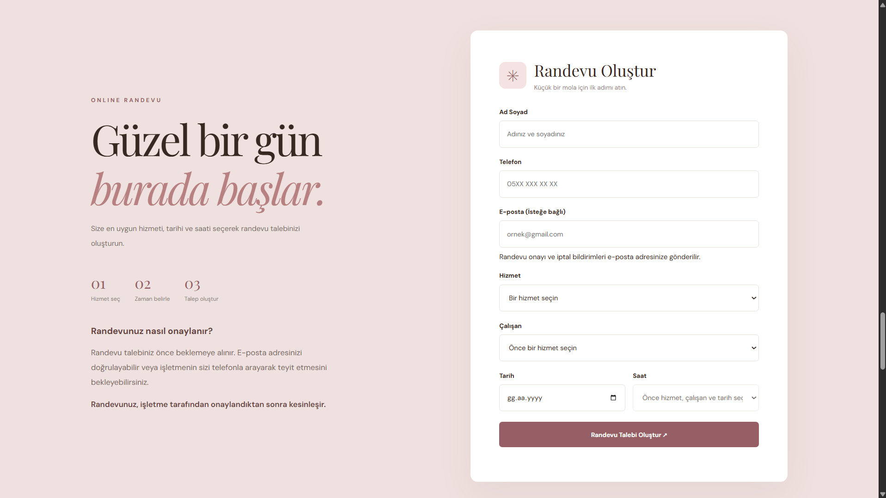
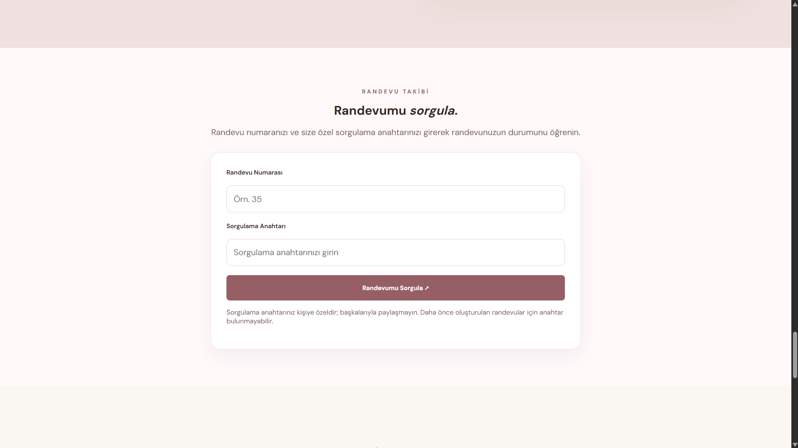
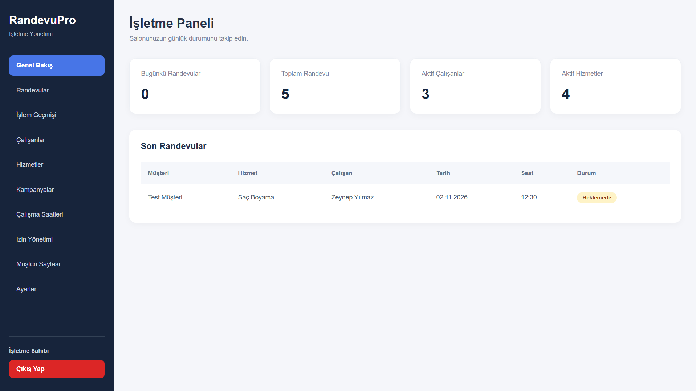
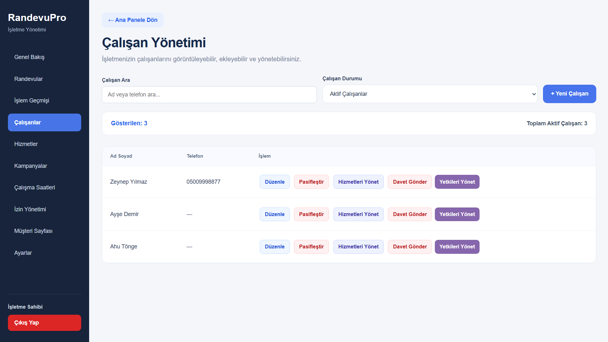
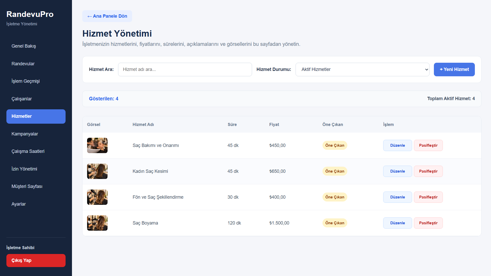
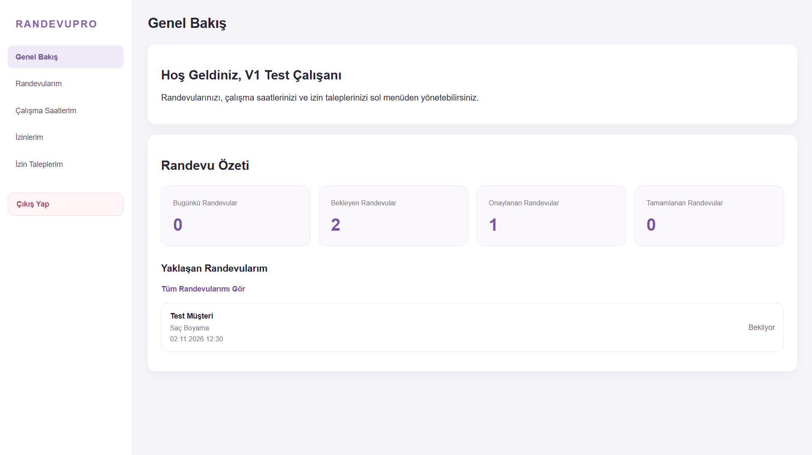
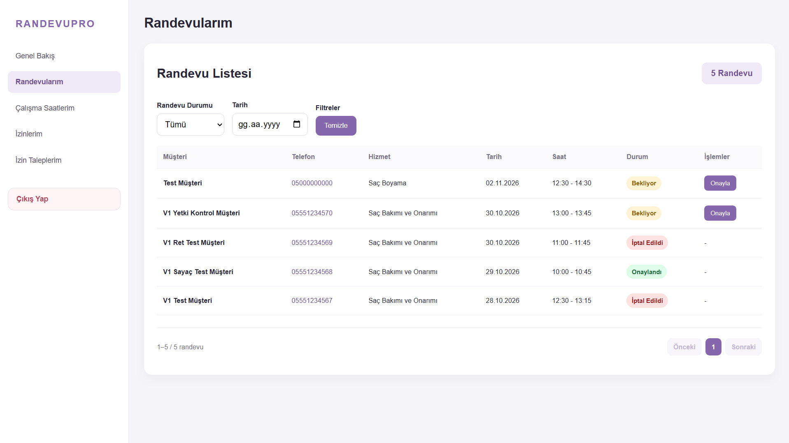
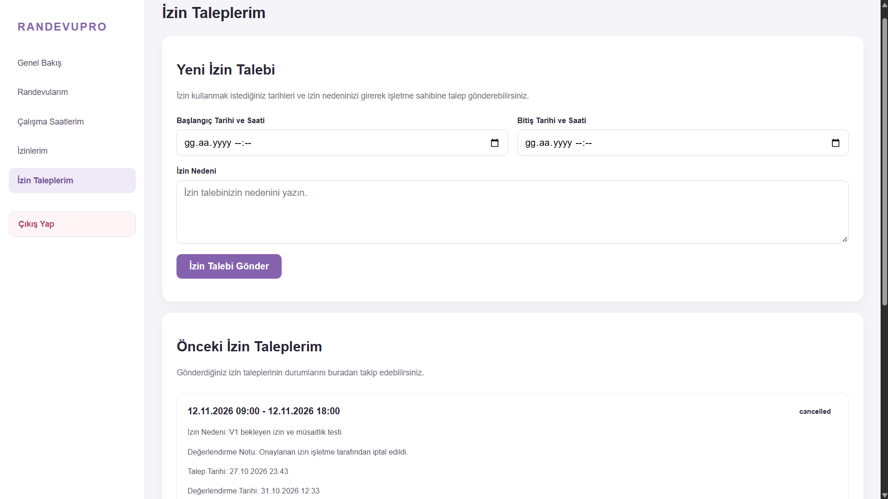

# RandevuPro

**Web Tabanlı Randevu Yönetim Sistemi**

🇹🇷 **Türkçe** | 🇬🇧 [English](README.md)

RandevuPro, hizmet sektöründeki işletmeler için geliştirilmiş web tabanlı bir randevu yönetim sistemidir. Müşterilerin kolayca randevu oluşturmasını sağlarken işletme sahiplerine, çalışanlara ve sistem yöneticilerine özel yönetim panelleri sunar.

Projenin amacı; randevu planlama, çalışan yönetimi ve günlük işletme operasyonlarını merkezi bir platform üzerinden daha düzenli ve verimli hâle getirmektir.

---

## Temel Özellikler

### Müşteri Arayüzü

Müşteriler kullanıcı dostu bir arayüz üzerinden hizmetleri inceleyebilir, tercih ettikleri çalışanı seçebilir ve uygun saatlerde randevu oluşturabilir.

- Hizmetleri ve çalışanları görüntüleme
- Randevu tarihi ve uygun saat seçimi
- E-posta doğrulamasıyla randevu oluşturma
- Mevcut randevuları sorgulama
- Geçerli kampanya ve indirimlerden yararlanma

### İşletme Sahibi Paneli

İşletme sahipleri randevuları, çalışanları ve hizmetleri tek bir panel üzerinden yönetebilir. Ayrıca çalışan yetkilerini, çalışma saatlerini ve işletme ayarlarını düzenleyebilir.

- Randevu, çalışan ve hizmet yönetimi
- Çalışan yetkilerini ve çalışma saatlerini düzenleme
- İzin ve çalışma dışı günleri yönetme
- Kampanya ve indirim oluşturma
- Randevu işlem geçmişini görüntüleme
- İşletmenin müşterilere açık web sayfasını özelleştirme

### Çalışan Paneli

Çalışanlar kendilerine özel panel üzerinden atanmış randevuları takip edebilir, yetkileri doğrultusunda randevu işlemleri gerçekleştirebilir ve izin taleplerini yönetebilir.

- Atanmış randevuları görüntüleme
- Yetkiye bağlı randevu işlemleri
- Çalışma programını görüntüleme
- İzin talebi oluşturma ve takip etme

### Süper Yönetici Paneli

Uygulamada sistem düzeyindeki yönetim işlemleri için ayrı bir süper yönetici alanı bulunmaktadır.

---

## Kullanılan Teknolojiler

| Kategori | Teknolojiler |
|---|---|
| Backend | Python, Flask |
| Veritabanı | PostgreSQL |
| Frontend | HTML, CSS, JavaScript |
| E-posta Entegrasyonu | Resend |
| Güvenlik | CSRF Koruması, Kimlik Doğrulama, Rol Tabanlı Yetkilendirme, Giriş Hızı Sınırlandırması |
| Sürüm Kontrolü | Git, GitHub |

---

## Ekran Görüntüleri

Aşağıdaki görseller RandevuPro'nun müşteri arayüzünü, işletme sahibi panelini ve çalışan panelini göstermektedir.

### Müşteri Arayüzü

Müşteriler bu arayüz üzerinden hizmetleri inceleyebilir, randevu oluşturabilir ve mevcut randevularını sorgulayabilir.

#### Ana Sayfa

#### Hizmetler

#### Randevu Oluşturma

#### Randevu Sorgulama

---

### İşletme Sahibi Paneli

İşletme sahibi paneli; randevuların, çalışanların, hizmetlerin ve işletme operasyonlarının merkezi olarak yönetilmesini sağlar.

#### Genel Bakış

#### Çalışan Yönetimi

#### Hizmet Yönetimi

---

### Çalışan Paneli

Çalışanlar kendilerine atanan randevuları görüntüleyebilir, yetkilerine göre randevu işlemleri gerçekleştirebilir ve izin taleplerini yönetebilir.

#### Genel Bakış

#### Randevularım

#### İzin Taleplerim

---

## Güvenlik Özellikleri

RandevuPro, kullanıcı oturumlarını ve uygulama işlemlerini korumak amacıyla çeşitli güvenlik mekanizmaları içerir.

- Oturum tabanlı kimlik doğrulama
- Rol tabanlı erişim kontrolü
- Hassas işlemlerde CSRF koruması
- Giriş denemelerinde hız sınırlandırması
- Çalışan yetkilerine göre işlem kontrolü
- Korunan yönetim API uç noktaları

---

## Proje Durumu

**Portföy Sürümü 1.0 — Son Testler ve Dokümantasyon**

Projenin son testleri, arayüz kontrolleri ve dokümantasyon çalışmaları devam etmektedir.

Müşteri randevu oluşturma sürecini ve yönetim panellerini gösteren bir demo videosu hazırlanması planlanmaktadır.

---

## Kaynak Kod ve Erişim

RandevuPro, yazılım mühendisliği portföyü kapsamında geliştirilmiş bir projedir.

Uygulamanın kaynak kodları **özel (Private) bir GitHub deposunda** tutulmaktadır.

Bu herkese açık depo yalnızca projenin özelliklerini, kullanılan teknolojileri, ekran görüntülerini ve tanıtım materyallerini paylaşmak amacıyla oluşturulmuştur.

**Uygulamanın kaynak kodları bu depoda herkese açık olarak paylaşılmamaktadır.**

---

## Geliştirici

**Sude Güngör**

Yazılım Mühendisi

- [GitHub](https://github.com/sudenurgungor)
- [Portföy](https://sudenurgungor.github.io/portfolio/)
